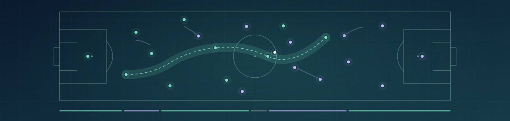
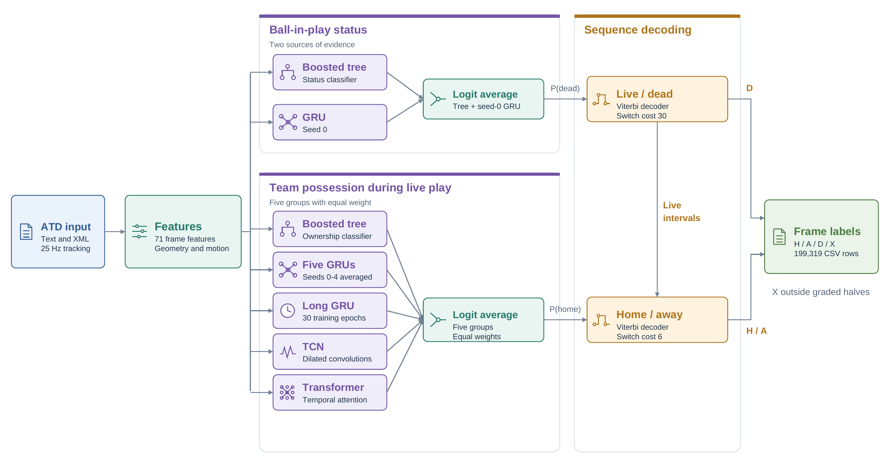

# MyRandi | Football possession from tactical tracking



<p align="center"><strong>More Than a Hack 2027 · Phase 1</strong><br/>Frame-level possession for FC Barcelona vs Athletic Club</p>

Our system converts automatic football tracking into a possession label for every frame of the tactical video. It combines geometric evidence from boosted trees with longer temporal context from recurrent, convolutional and attention networks. Two sequence decoders identify stoppages and assign the team in possession during live play.

| Output | Input | Model |
| --- | --- | --- |
| 199,319 rows at 25 frames per second | Tactical ATD text and XML metadata | Two boosted-tree classifiers, eight temporal networks and two Viterbi decoders |

[Challenge](#the-challenge) · [Architecture](#architecture) · [Design evolution](#design-evolution-and-selection) · [Reproduction](#reproduce-the-submission) · [Training data](#training-data-and-supervision) · [Results](#evaluation-and-results) · [Team](#team)

## The challenge

This is **MyRandi's Phase 1 submission to More Than a Hack 2027**, organised by Metrica Sports, FC Barcelona through Barça Innovation Hub, and Mobile World Capital Barcelona. The task is to assign possession to every frame of the supplied Barcelona–Athletic tactical recording. A possession is a continuous interval of team control, so a convincing sequence of frame predictions must also have credible boundaries and avoid spurious changes.

The tactical recording is the reference: **199,319 frames at 25 Hz**. Home is Barcelona and away is Athletic Club. The organiser reports that the ball is missing on about 41% of graded frames; track slots are fragmented and do not represent persistent player identities. The broadcast recording has a separate timeline with cuts and replays. These properties motivate missingness-aware features and temporal inference on the tactical grid.

**Optimisation target:** SpellF1, the organiser's possession-interval metric; MacroF1 breaks ties. Presentation is intended to make the method inspectable. The private full-match score determines the ranking.

## Asset choices

| Provided asset | Final use | Reason |
| --- | --- | --- |
| Tactical ATD text | Required inference input | Ball/player geometry, movement and visibility on the reference timeline |
| Tactical ATD XML | Required inference input | Track-slot and team metadata needed to interpret the text export |
| Tactical video and homography | Excluded from final inference | The submitted model consumes pitch coordinates directly; it does not run an image detector or camera-to-pitch projection |
| Smart Tagging XML | Excluded from final inference | Earlier exploratory agreement checks did not make automatic phase tags into possession ground truth; the final prediction path does not read them |
| Broadcast video, ATD and homography | Excluded from final inference | Camera cues were explored in prototypes; the final model avoids an unverified cross-camera timeline mapping |
| Public five-minute possession labels | Frozen-pipeline correctness check only | Excluded from model fitting, threshold tuning, decoder selection and architecture selection |

Only the two tactical ATD files and the packaged checkpoints are needed to regenerate the CSV. The repository contains no match data, video frames or reconstructive tracking exports.

## Architecture



[Open the vector diagram](assets/architecture.svg).

### Tracking and feature extraction

The parser reads the ball, player slots and team assignments from the supplied tactical files. Features describe the nearest player on each team, distances to the ball, crowding, ball speed, visibility, collective movement and team shape. Ball gaps with observed endpoints are linearly interpolated for up to eight frames. Longer gaps retain missingness information for the learned models.

Two histogram gradient-boosting classifiers operate on these features. The status classifier estimates the probability that the ball is dead. The ownership classifier estimates the probability of home possession conditional on live play. Each supplied classifier contains 300 fitted iterations, with a learning rate of 0.05 and at most 31 leaves per tree.

### Temporal modelling

The neural networks consume the feature sequence at 5 Hz. Each training window contains 512 steps, approximately 102 seconds of play. A fitted normaliser standardises the features and adds missingness indicators.

| Component | Architecture | Role in the ensemble |
| --- | --- | --- |
| Five seeded GRUs | Two bidirectional layers with 64 hidden units per direction | Average across seeds to reduce dependence on a single fit |
| Longer-trained GRU | The same recurrent architecture, trained for 30 epochs | Add a model fitted with a larger optimisation budget |
| Temporal convolutional network | Eight 64-channel residual blocks, two size-3 convolutions per block and dilations from 1 to 128 | Capture movement patterns over multiple temporal scales |
| Transformer | Three encoder layers, four attention heads, a 64-dimensional representation and a 256-unit feed-forward layer | Model interactions across the input window |

The standard neural fits use 12 epochs, 40 batches per epoch and 32 windows per batch. They use AdamW with a maximum learning rate of 0.002, OneCycle scheduling, weight decay of 0.0001 and gradient clipping at 1.0. Cross-entropy supervises the home, away and dead-ball outputs. At inference, the transformer combines overlapping windows. The class logits are interpolated from 5 Hz back to the 25 Hz tactical timeline.

This is **offline, full-match inference**. Bidirectional recurrence, centred/future feature windows and transformer context use later observations to resolve earlier uncertainty. The 5 Hz grid reduces neural computation; output labels and both decoders still operate at 25 Hz. The method does not claim causal, real-time prediction or native 25 Hz neural attention.

### Fusion and sequence decoding

For live/dead status, we average the status tree and seed-0 GRU evidence in logit space. For team possession, the five seeded GRUs first form one group. We then equally weight five contributions—the ownership tree, that GRU group, the longer-trained GRU, the TCN and the transformer. The team probability is conditional on live play.

Each neural model converts its three class outputs into dead-ball probability and conditional home probability, `P(H) / (P(H) + P(A))`. Fusion averages their log-odds so both model families contribute evidence on the same scale.

A two-state Viterbi decoder places live/dead intervals with a switch cost of 30. A second two-state decoder assigns home or away inside each live interval with a switch cost of 6. These costs were chosen during external-match development. Transition penalties discourage isolated changes in weak evidence, while sustained opposing evidence can establish a new possession.

| Label | Meaning |
| --- | --- |
| `H` | Home team possession during live play |
| `A` | Away team possession during live play |
| `D` | Dead ball or stoppage |
| `X` | Frames outside the organiser’s two graded halves |

### Possession semantics

The status decoder determines stoppages; the ownership decoder works only within its live intervals. A restart is therefore an inferred return to live play, followed by a team assignment from that interval's evidence. An unobserved ball is not automatically dead: collective motion, surrounding visibility and temporal context remain available.

During loose balls and challenges, the team switch penalty resists a transfer caused by a brief proximity change. The external training labels also apply a one-second control heuristic: a short opposing spell is folded into the preceding team when that team immediately regains possession or play stops; short spells after restarts are retained. This is a modelling convention, not a one-second rule supplied by the organiser. It can erase genuine brief possessions.

`X` is emitted outside the published graded halves, not as a substitute for difficult missing-ball frames inside them. There are no manual match-specific label corrections. Physical boundary refinement and a hard-coded kickoff override are disabled in the submitted decoder.

## Design evolution and selection

The final architecture keeps the frame-wise learner as a geometric reference and adds temporal diversity specifically where it helped ownership. The following historical external-development summaries explain the design decisions. They are recorded ablations, not a new independent test or private challenge scores.

| Design stage | Original 10-match SpellF1 | What it established |
| --- | ---: | --- |
| Externally trained boosted trees | 65.4% | Geometry and movement provide a useful baseline without fitting on the challenge match |
| Boosted trees plus one bidirectional GRU | 69.8% | Sequence context adds useful information beyond frame features |
| Diverse fusion for both status and team | 72.2% | Stronger on the original cohort, but SkillCorner fell from 59.5% to 59.0% |
| **Submitted: conservative status branch, diverse ownership branch** | **71.89%** | Retains the status tree + seed-0 GRU and improves the SkillCorner development result to **60.05%** |

Five GRU seeds are averaged before joining the other model groups so the recurrent family does not receive five times the weight. The longer-trained GRU, TCN and transformer contribute different temporal representations. A learned stacker was explored; the submitted fusion uses explicit equal group weights.

More computation was not adopted by default. A 109-setting tree search improved trees alone but added only about 0.1 percentage point to the tree–GRU pipeline. Adding SkillCorner supervision improved performance on its own convention while reducing the original-cohort score, so it was omitted from the shipped weight training. Boundary shifts, a joint three-state decoder and post-hoc short-spell merging did not provide sufficiently consistent evidence across label conventions. The submitted system preserves the two-stage decoder and the original tree settings.

The SkillCorner results influenced the final branch separation. Whole-match exclusion prevents direct fitting on each validation match, but repeated development still creates selection bias. A new, untouched labelled cohort would be needed for an independent estimate after architecture selection.

### What further R&D taught us

We also completed a separate, matched-input study of a ball-to-player attention specialist at 5 Hz and native 25 Hz. Across five external whole-match folds, 55 component fits completed and 90 official metric reports were replayed. Under its primary ball-gap stress with original provider labels, the refitted reference scored 61.84% SpellF1 and the 25 Hz specialist scored 61.83%; short-spell precision fell from 58.87% to 56.70%. The specialist failed the predeclared improvement checks and is **not part of the submission**.

This study supports retaining the existing model rather than adding attention simply because it is more detailed. It also showed why we track short-spell precision alongside recall: a system can create extra short possessions without recovering more genuine changes. These five-fold stress scores use a different protocol from the ten-match development table and must not be compared directly with 71.89%.

[Recorded research summary and advancement checks](assets/research-evidence.json).

## Reproduce the submission

### Environment and data

Use **Python 3.12 on Linux x86-64**. All Python dependencies, including the CPU build of PyTorch, are pinned in [requirements.txt](requirements.txt). The required pretrained checkpoints are in `solution/models/`.

Place the supplied tactical files in this layout.

```text
data/
└── tactical/
    ├── BAR-ATH_tactical_atd.txt
    └── BAR-ATH_tactical_atd.xml
```

For a data bundle stored elsewhere, set `MTAH_DATA_DIR` to its parent directory containing `tactical/` before starting the program.

```bash
export MTAH_DATA_DIR="/absolute/path/to/data_bundle"
```

### Install, generate and validate

Run the following commands from the repository root.

```bash
python3.12 -m venv .venv
.venv/bin/python -m pip install -r requirements.txt
export OMP_NUM_THREADS=4 OPENBLAS_NUM_THREADS=4 MKL_NUM_THREADS=4
.venv/bin/python solution/run.py --name submission
.venv/bin/python evaluation/validate_submission.py evaluation/results/submission.csv
sha256sum -c expected_submission.sha256
```

The first inference run creates a local tracking cache. The resulting `evaluation/results/submission.csv` contains the exact header `frame,label` and 199,319 ordered data rows. Its expected SHA-256 is recorded in [expected_submission.sha256](expected_submission.sha256).

A clean checkout using the two tactical files and the pinned environment reproduced the uploaded CSV byte for byte. This reproduction uses the packaged weights. The source also includes the external-data preparation and model-training implementations.

### What is reproduced

The command above **runs the trained models**; it does not retrain them. It requires no video processing, external-data download, GPU, API key or hosted inference service. The bundled weights and their fitted normalisers are the release artifacts used for exact-file reproduction. Full retraining from the external sources is a separate development workflow; byte equality of independently retrained checkpoints has not been established.

The submission file is named `MyRandi.csv` for the organiser's form. The command uses the neutral local filename `submission.csv`; its bytes must match the upload. `expected_submission.sha256` checks that generated path. To write a team-named copy, use `--name MyRandi` and compare its checksum with the same expected digest.

If execution cannot locate the data, check that `MTAH_DATA_DIR` points to the directory **containing** `tactical/`. If a checkpoint is missing, restore the nine files under `solution/models/`. Unset `MTAH_RETRAIN` before release inference. Delete only the local generated `solution/cache/` if a cache was created from a different bundle. Do not pad or trim tracking or video to satisfy the output row count.

## Training data and supervision

| Dataset | Scale | Labels and use |
| --- | --- | --- |
| DFL/Sportec IDSSE | Seven German league matches; 1,002,644 labelled H/A/D frames | Provider ball status and possession fields support model fitting and match-level development |
| Metrica Sports sample data | Three anonymised matches; 424,975 labelled H/A/D frames | Analyst event logs supply the events used to derive possession and stoppage targets |
| SkillCorner Open Data | Twenty A-League matches | Provider phases of play supply a cross-provider development check that informed the final ensemble |

The shipped weights were fitted on the ten DFL/Sportec and Metrica matches, comprising 1,427,619 labelled H/A/D frames before augmentation (approximately 1.43 million). These counts exclude `X` and do not multiply repeated windows. Each training match has two seeded corruption draws. Augmentation introduces state-dependent ball dropout, missing players, duplicate tracks and team-identity errors.

We apply a one-second heuristic to external labels to approximate controlled possession. A brief opposing spell is assigned to the preceding team when that team immediately regains the ball or play stops. Short spells following a restart are retained. This is an implementation choice within the external-label preparation.

Sources and access conditions are documented in the provider releases. DFL/Sportec IDSSE is released under CC BY 4.0. Metrica publishes its sample data for community use. SkillCorner Open Data uses the MIT licence. The downloader and exact input checksums are included. [DFL/Sportec dataset](https://doi.org/10.1038/s41597-025-04505-y) · [Metrica sample data](https://github.com/metrica-sports/sample-data) · [Pinned SkillCorner release](https://github.com/SkillCorner/opendata/tree/4340d274572876239c154c90bc507a9b3250a656).

## Evaluation and results

The organiser ranks submissions by **SpellF1**, averaged across possession overlap thresholds of 0.3, 0.4, 0.5, 0.6 and 0.7. MacroF1 is the first tie-break. We evaluate external matches with the organiser’s metric implementation and whole-match exclusion from fitting.

| External development cohort | SpellF1 with control heuristic | SpellF1 with provider labels |
| --- | ---: | ---: |
| Ten DFL/Sportec and Metrica matches | 71.89% | 65.37% |
| Twenty SkillCorner matches | 60.05% | 59.78% |

The original cohort uses simulated tracking degradation. SkillCorner contributes actual broadcast tracking noise and informed the separation of the status and ownership ensembles. These scores describe the respective development protocols.

**Evidence scope:** the ten-match and SkillCorner summaries above were checked by reaggregating the archived v7 per-match reports. We independently reran challenge-file inference and exact-byte reproduction. The later five-fold attention study was trained and scored separately; the original v7 ten-match training sweep was not rerun as part of packaging.

The public Barcelona–Athletic labels cover five minutes and serve as a correctness check after freezing the CSV. Full-match ground truth is held by the organiser. To run the public diagnostic, use the evaluator and labels from the challenge checkout.

| Frozen challenge-file diagnostic | Value | Scope |
| --- | ---: | --- |
| SpellF1 | 61.33% | Public 7,500-frame window, 17 true possessions |
| MacroF1 | 77.87% | Same public window |
| Frame accuracy | 83.59% | Same public window; not the ranking metric |

These values verify the frozen output through the official evaluator. They are not a full-match performance estimate and were not used to select the submission. The external cohort averages and the public window use different matches, tracking quality and label conventions, so they should not be compared as if they were one test set.

```bash
.venv/bin/python /absolute/path/to/challenge/evaluation/run_evaluation.py \
  --gt public \
  --results evaluation/results \
  --out evaluation/reports \
  --bootstrap 1000
```

## Limitations

Synthetic dropout can differ from the actual tracking loss in a particular camera view. Player identity swaps can give the wrong team convincing proximity evidence. Label conventions differ between providers, and transition penalties can suppress genuine short possessions. Further work would test restart timing on independent matches with long natural gaps and evaluate track-identity consistency.

The ensemble cannot recover observations that were never tracked; long occlusions can leave the boundary placement uncertain. Its future context also prevents immediate streaming use. More independent matches with natural tracking failures, explicit short-possession labels and restart timing would be more useful validation than further searches on the same development cohorts.

## Repository guide

| File or directory | Purpose |
| --- | --- |
| `solution/run.py` | Submission inference command |
| `solution/parse_atd.py`, `solution/features.py` | Tactical parsing and feature extraction |
| `solution/supervised.py`, `solution/temporal.py` | Boosted-tree and temporal model implementations |
| `solution/models/`, `solution/models_store.py` | Packaged checkpoints and loading |
| `solution/decode.py` | Probability fusion and Viterbi decoding |
| `solution/external.py`, `solution/augment.py` | External labels and tracking augmentation |
| `solution/download_external.sh`, `solution/external_sha256.txt` | External-data download and integrity checks |
| `evaluation/` | Organiser’s metric, evaluation and CSV-validation scripts |

## Team

| Team member | Email |
| --- | --- |
| Saran BA | [saranba23417@gmail.com](mailto:saranba23417@gmail.com) |
| Aditya B | [aditya2110b@gmail.com](mailto:aditya2110b@gmail.com) |
| Madhav Arul | [madhavvarul@gmail.com](mailto:madhavvarul@gmail.com) |
| Roahith R | [roahith11@gmail.com](mailto:roahith11@gmail.com) |

## Acknowledgements

The benchmark, evaluation code and copied licence originate from Metrica Sports and Barça Innovation Hub. The [benchmark citation](CITATION.cff) identifies their challenge. We acknowledge the external data providers for the tracking and annotations used in development. [Challenge repository](https://github.com/metrica-sports/more-than-a-hack-2027) · [Licence](LICENSE).
